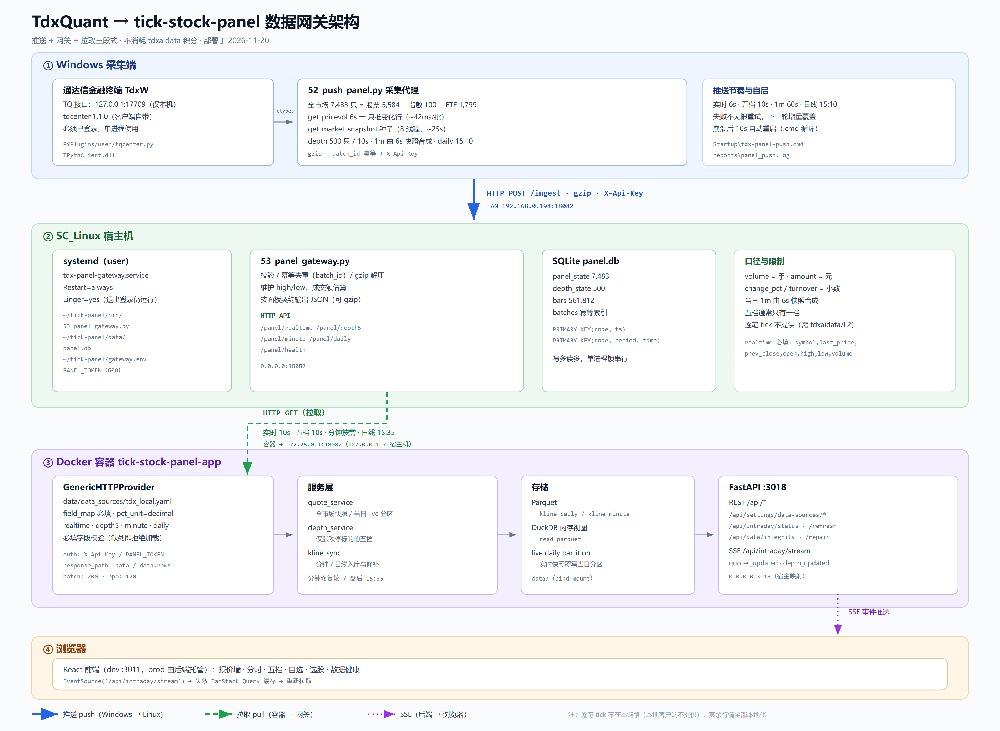

# tdx_local_data_source

用**本机通达信金融终端**给 [tick-stock-panel](https://github.com/bhlt/tick-stock-panel) 供数的数据网关。

不依赖 tdxaidata、不消耗积分：Windows 采集 → Linux 网关 → 面板按契约拉取。



## 组成

| 组件 | 平台 | 作用 |
|---|---|---|
| `agent/52_push_panel.py` | Windows | 从 tqcenter 取数，主动 push（gzip + token） |
| `gateway/53_panel_gateway.py` | Linux | 接收、幂等落 SQLite、按面板契约输出 HTTP |
| `tools/54_check_panel_contract.py` | 任意 | 契约自检 |
| `deploy/tick-stock-panel/data_sources_tdx_local.yaml` | 面板 | 数据源配置（放入 `data/data_sources/`） |

## 快速开始

推荐直接用部署脚本：

```bash
# Linux 网关（自动建目录、token、systemd、linger）
./deploy/systemd/install.sh
```

```powershell
# Windows 采集代理（生成 .cmd + 开机自启）
powershell -ExecutionPolicy Bypass -File deploy\windows\install-startup.ps1 `
  -Token <token> -Receiver http://<linux-ip>:18082
```

手动步骤见下文。

### 1. Linux：启动网关

```bash
mkdir -p ~/tick-panel/{bin,data}
cp gateway/53_panel_gateway.py ~/tick-panel/bin/

export PANEL_TOKEN='<强密码>'
python3 ~/tick-panel/bin/53_panel_gateway.py \
  --host 0.0.0.0 --port 18082 \
  --db ~/tick-panel/data/panel.db
```

建议用 systemd user 服务（`Linger=yes`），示例见 `docs/部署记录.md`。

### 2. Windows：启动采集代理

```powershell
set TDX_PYPLUGINS=C:\new_tdx64\PYPlugins\user
set PANEL_TOKEN=<强密码>

python agent\52_push_panel.py ^
  --receiver http://<linux-ip>:18082 ^
  --market 5 --include-markets 9,31 ^
  --interval 6 ^
  --depth-market 24 --depth-limit 500 ^
  --minute-market 24 --minute-limit 500 ^
  --daily-auto --daily-markets 5,31,9 ^
  --daily-codes 000001.SH,000002.SH,399107.SZ --daily-count 30 ^
  --no-seed
```

`agent/52_push_panel.cmd.example` 是带自动重启的循环模板，复制为 `.cmd` 后改三处即可。

### 3. 面板：接入数据源

```bash
cp deploy/tick-stock-panel/data_sources_tdx_local.yaml \
   <panel>/data/data_sources/tdx_local.yaml

curl -X POST http://127.0.0.1:3018/api/settings/data-sources/reload
curl -X PUT  http://127.0.0.1:3018/api/settings/preferences/data-providers \
  -H "Content-Type: application/json" \
  -d '{"realtime_data_provider":"tdx_local","depth5_data_provider":"tdx_local","minute_data_provider":"tdx_local","daily_data_provider":"tdx_local"}'
```

> 面板跑在 Docker 时，YAML 里的 URL 要用 **Docker 网关 IP**（如 `172.25.0.1:18082`），不能用 `127.0.0.1`。

## 数据契约

| 数据集 | 频率 | 关键字段 |
|---|---|---|
| realtime | 6s 推 / 10s 拉 | symbol, last_price, prev_close, open, high, low, volume, amount, **timestamp** |
| depth5 | 10s | asks/bids = `[[价, 手]×5]` |
| minute | 每分钟 | symbol, datetime, OHLC, volume, amount |
| daily | 15:10 推 / 15:35 拉 | symbol, date, OHLC, volume, amount |

- `volume` 单位手、`amount` 单位元、`change_pct` 小数
- **`timestamp` 必须在 YAML `field_map` 中映射**，否则面板 `quote_ts` 为空，自选列表显示「时间未确认」
- realtime 必须是**全市场**（面板会用全量行覆写当日 live 分区）

## 关键设计

- **增量推送**：只推变化行；另发 `panel_beat` 心跳更新全市场行情时间，避免无成交个股显示「更新延迟」
- **幂等**：`batch_id` 去重；`(code, ts)` / `(code, period, time)` 主键
- **停牌兜底**：无快照标的用 `get_pricevol` 补齐，保证全市场行数
- **当日 1 分钟线**：本地 1m 只到上一交易日，当日由 6s 快照合成（标签对齐通达信）
- **零第三方依赖**：网关与代理都只用标准库

## 已知限制

- **逐笔 tick 不提供**：本地客户端无 `get_tick_data`，需要 tdxaidata 或 L2
- 五档通常只有一档（客户端不在该股报价页时，2~5 档为空）
- 本地 1m 历史只有最近数十个交易日
- 全市场 6 秒一轮，取数约 4 秒，不建议再调快

## 故障排查

| 现象 | 处理 |
|---|---|
| 自选显示「时间未确认」 | YAML realtime.field_map 补 `timestamp: timestamp`，reload |
| 自选显示「更新延迟」 | 确认代理在发 `panel_beat`；检查代理是否卡住 |
| 面板实时为空 | `curl /panel/health` 看 `panel_state`；为 0 则检查代理与 token |
| 日线全部为空 | 检查网关日期过滤是否按 `YYYY-MM-DD` 比较 |
| 容器重建后配置丢失 | `data/` 是 bind mount；重跑 `docker cp` 与 reload |

## 目录

```
agent/     Windows 采集代理 + 启动模板
gateway/   Linux 数据网关
tools/     契约自检
deploy/    面板数据源 YAML
docs/      架构图、接入方案、部署记录
```

## 要求

- Windows 侧：通达信金融终端（支持 TQ），`tqcenter` 1.1.0+，Python 3.10+
- Linux 侧：Python 3.10+，无需第三方库
- 面板：支持 `data/data_sources/*.yaml` 自定义源
