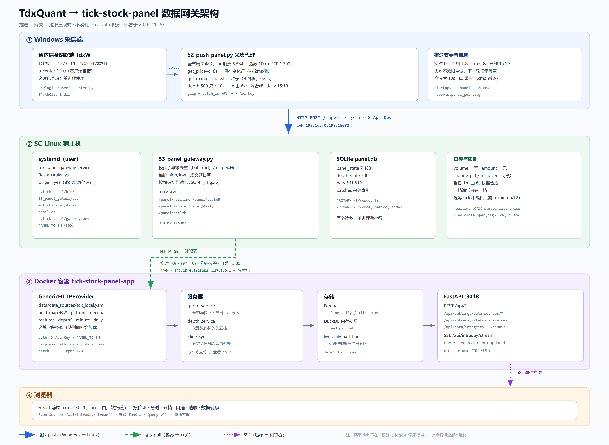

# 部署记录：通达信 → tick-stock-panel

> 部署时间：2026-11-20
> 目标机器：SC_Linux（`shencan@192.168.0.198`）
> 面板：Docker 容器 `tick-stock-panel-app`（宿主 3018 → 容器 3018）
> 数据链路：Windows 通达信 →（push）→ Linux 网关 →（pull）→ 面板

---

## 0. 架构图



- 源文件：`docs/architecture.svg`（矢量）、`docs/architecture.mmd`（Mermaid，可编辑）
- 实线蓝箭头：Windows 主动推送；虚线绿箭头：容器向网关拉取；点线紫箭头：后端向浏览器推 SSE

三条数据流：

1. **推送**：`52_push_panel.py` 每 6 秒把 7483 只的变化行情 POST 到 `192.168.0.198:18082`，五档 10 秒、1m 每分钟、日线 15:10。
2. **拉取**：面板 `GenericHTTPProvider` 按 10 秒轮询 `/panel/realtime`，五档/分钟按需，日线 15:35；容器内用 `172.25.0.1` 访问宿主机。
3. **SSE**：`/api/intraday/stream` 仅负责后端→浏览器通知，不参与数据接入。

---

## 1. 最终状态

| 组件 | 位置 | 状态 |
|---|---|---|
| 采集代理 | Windows：`agent\52_push_panel.py` | 运行中（开机自启） |
| 数据网关 | SC_Linux：`/home/shencan/tick-panel/bin/53_panel_gateway.py` | systemd user 服务，active |
| 网关数据 | `/home/shencan/tick-panel/data/panel.db` | 7483 只标的、56 万根 K 线 |
| 面板数据源 | 容器 `/app/data/data_sources/tdx_local.yaml` | 已加载，`errors: []` |
| 面板偏好 | realtime/depth5/minute/daily = `tdx_local` | 已生效 |
| 实时轮询 | 10 秒（`realtime_quote_interval`） | 已设置 |

实测：

```
网关 /panel/health : panel_state=7483, depth=500, bars=561812
面板 /api/intraday/status : symbol_count=5660, index=92, etf=1731, quote_age≈8s（手动刷新）
面板日线自检 : status=clean, issues=[]
```

---

## 2. Linux 端脚本放在哪、怎么跑

### 2.1 目录（推荐，已采用）

```
/home/shencan/tick-panel/
├── bin/53_panel_gateway.py     # 程序
├── data/panel.db               # SQLite 数据
├── gateway.env                 # PANEL_TOKEN（600 权限）
├── logs/                       # 预留
└── ~/.config/systemd/user/tdx-panel-gateway.service
```

选择理由：

- 不需要 sudo（`/opt` 需要 root，而当前账号无免密 sudo）；
- 程序与数据分离，容器重建不影响；
- 用 **systemd user 服务**，`loginctl enable-linger shencan` 已开启，退出登录后仍运行。

### 2.2 systemd 用户服务

```ini
[Unit]
Description=TDX panel gateway
After=network.target

[Service]
EnvironmentFile=%h/tick-panel/gateway.env
ExecStart=/usr/bin/python3 %h/tick-panel/bin/53_panel_gateway.py --host 0.0.0.0 --port 18082 --db %h/tick-panel/data/panel.db
Restart=always
RestartSec=3

[Install]
WantedBy=default.target
```

```bash
systemctl --user status tdx-panel-gateway
systemctl --user restart tdx-panel-gateway
journalctl --user -u tdx-panel-gateway -f
```

### 2.3 绑定与网络

- 网关监听 `0.0.0.0:18082`，Windows 通过 `192.168.0.198:18082` 推送；
- 面板容器通过 Docker 网关 `172.25.0.1:18082` 拉取（容器内 `127.0.0.1` 不是宿主机）；
- 如后续加防火墙，只需放行 Windows 主机 IP 到 18082。

---

## 3. 面板侧配置（已完成）

### 3.1 数据源 YAML

宿主机：`~/workspace/github/tick-stock-panel/data/data_sources/tdx_local.yaml`
容器内：`/app/data/data_sources/tdx_local.yaml`（bind mount，重建容器不丢）

关键配置：

```yaml
name: tdx_local
auth: {type: header, header: X-Api-Key, token_env: PANEL_TOKEN}
datasets:
  realtime: {url: 'http://172.25.0.1:18082/panel/realtime', response_path: data, pct_unit: decimal, field_map: {...}}
  depth5:   {url: '.../panel/depth5',  response_path: data, symbols_param: symbols, batch: 200, field_map: {...}}
  minute:   {url: '.../panel/minute',  response_path: data.rows, ...}
  daily:    {url: '.../panel/daily',   response_path: data.rows, ...}
```

> `field_map` 必填（loader 用 `field_map.values()` 校验）；`adj_factor_provider` 保持原值，未指向 tdx_local。

### 3.2 Token

`PANEL_TOKEN=efde...` 已写入项目根 `.env`（容器只读挂载为 `/app/.env`），provider 每次请求时读取。

### 3.3 已执行的 API

```text
POST /api/settings/data-sources/reload
PUT  /api/settings/preferences/data-providers
PUT  /api/settings/preferences/realtime-quotes
PUT  /api/settings/preferences/quote-interval   → 10s
POST /api/data/integrity/scan + /integrity/repair （补齐历史缺口）
```

---

## 4. Windows 侧自启

- 计划任务被系统拒绝（无权限），改用**用户启动目录**：

```
C:\Users\baoba\AppData\Roaming\Microsoft\Windows\Start Menu\Programs\Startup\tdx-panel-push.cmd
```

- 实际循环脚本：`agent\52_push_panel.cmd`
  - 设置 `TDX_PYPLUGINS`、`PANEL_TOKEN`、`PYTHONUNBUFFERED`
  - 使用绝对路径的 Python
  - 进程退出后 10 秒自动重启
- 日志：`D:\workspace\TdxQuant\reports\panel_push.log`

同步内容与频率：

| 项目 | 频率 | 说明 |
|---|---|---|
| 实时池 | 6 秒 | 股票 5584 + 指数 100 + ETF 1799 = 7483，只推变化行 |
| 快照心跳 | 6 秒 | `panel_beat` 仅更新全市场行情时间（约 100 字节），避免无成交个股显示「更新延迟」 |
| 五档 | 10 秒 | 中证500（500 只） |
| 1 分钟线 | 实时合成 | 本地 1m 只到上一交易日，当日由快照按分钟合成 |
| 日线 | 每日 15:10 | 股票 + ETF + 指数，含 3 个补充指数代码 |

---

## 5. 运维命令

```bash
# 网关
systemctl --user status tdx-panel-gateway
systemctl --user restart tdx-panel-gateway
curl -H "X-Api-Key: $PANEL_TOKEN" http://127.0.0.1:18082/panel/health

# 面板
curl -X POST http://127.0.0.1:3018/api/settings/data-sources/reload
curl -X POST http://127.0.0.1:3018/api/intraday/refresh
curl http://127.0.0.1:3018/api/intraday/status
curl http://127.0.0.1:3018/api/data/integrity
```

Windows：

```powershell
Get-Content D:\workspace\TdxQuant\reports\panel_push.log -Tail 20
Get-CimInstance Win32_Process -Filter "Name='python.exe'" | ? { $_.CommandLine -match '52_push_panel' }
```

---

## 6. 部署中发现并修复的问题

| # | 问题 | 修复 |
|---|---|---|
| 1 | 网关日线查询用 `YYYY-MM-DD HH:MM:SS` 比较 `YYYY-MM-DD`，导致日线全空 | 日线按日期前 10 位比较 |
| 2 | 面板容器内 `127.0.0.1` 不是宿主机 | YAML 改用 Docker 网关 `172.25.0.1` |
| 3 | 面板实时池要求全市场，只推自选会截断当日分区 | 全市场 seed + 停牌兜底 + 增量 |
| 4 | ETF/指数日线缺失导致实时开关被锁 | 补 `--daily-markets 5,31,9` 与 3 个补充指数 |
| 5 | 3 个指数（000001.SH/000002.SH/399107.SZ）不在任何市场池 | 新增 `--daily-codes` 显式补充 |
| 6 | 本地 1m 只到上一交易日 | 快照合成当日分钟线（标签对齐通达信：09:30~09:31 记 09:31） |
| 7 | 面板默认 60 秒轮询，本地源没必要这么慢 | 改为 10 秒 |
| 8 | 自选列表显示「时间未确认」 | YAML 的 `field_map` 漏了 `timestamp`，导致 `quote_ts` 为空；补上后恢复 `live` |
| 9 | 无成交个股几分钟后变成「更新延迟」 | 代理只推变化行；增加 `panel_beat` 心跳（每轮更新全市场行情时间） |

---

## 7. 已知限制

1. **逐笔 tick 不提供**：本地客户端无 `get_tick_data`，面板若需要逐笔仍需 tdxaidata 或 L2。
2. **五档通常只有一档**：客户端不在该股报价页时，买二~买五/卖二~卖五为空。
3. **午休/非交易时段不轮询**：面板 `is_trading_hours=false` 时不拉取，`quote_age` 变大属正常。
4. **当日 1m 为合成数据**：高低价来自 6 秒采样，极端瞬间可能漏掉；历史 1m 为客户端真实数据。
5. **全市场 6 秒一轮**：Windows 端取数约 4 秒，留有余量但不宜再调快。

---

## 8. 故障恢复

| 现象 | 处理 |
|---|---|
| 面板实时无数据 | 查网关 `/panel/health` 的 `panel_state`；为 0 则重启 Windows 代理 |
| 网关挂了 | `systemctl --user restart tdx-panel-gateway` |
| 容器重建后 YAML 丢失 | `data/` 是 bind mount，通常不会丢；重跑 `docker cp` 与 reload |
| 交易日但面板不刷新 | 检查 `is_trading_hours` 与 `realtime_quotes_enabled` |
| 日线又出现缺口 | 先跑 15:10 自动补日线，再执行 `integrity/scan + repair` |

